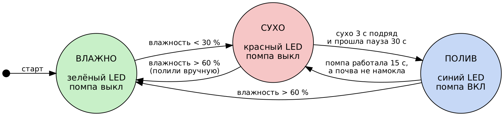

# SmartSprout — автополив растения на ESP32

Мини-проект «Робот как система», МИР, КГТУ.

**Команда:** Базарбаев Урмат, Уланбекова Жибек, Таштанбеков Имангали.

## Что делает устройство
SmartSprout сам следит за влажностью почвы в горшке и поливает растение, когда земля пересохла. Ёмкостный датчик постоянно измеряет влажность, ESP32 сглаживает показания и решает, что делать, а реле включает мини-помпу. Когда почва стала достаточно влажной, помпа выключается. Три светодиода показывают состояние: красный — сухо, синий — идёт полив, зелёный — норма.

- **Датчик (Sense):** ёмкостный датчик влажности почвы v1.2, аналоговый сигнал на `GPIO34`.
- **Обработка (Think):** скользящее среднее по 10 замерам (2 с), пересчёт в проценты, пороги с гистерезисом 30 % / 60 % — [код](src/smartsprout/smartsprout.ino).
- **Решение:** конечный автомат СУХО → ПОЛИВ → ВЛАЖНО — [рисунок](docs/fsm.png).
- **Действие (Act):** реле с мини-помпой 5V, светодиоды состояния.

## Файлы
| Что | Где |
|---|---|
| Код (Arduino, ESP32) | `src/smartsprout/smartsprout.ino` |
| Схема подключения | `docs/wiring.md` |
| Конечный автомат | `docs/fsm.png` (исходник `docs/fsm.dot`) |
| Sense–Think–Act | `docs/sense_think_act.md` |
| Смета | `smeta.md` |
| Видео до 1 мин | `video.mp4` |

## Как запустить
1. Arduino IDE 2 → плата **ESP32 Dev Module** (пакет esp32 от Espressif). Внешние библиотеки не нужны.
2. Собрать схему по `docs/wiring.md`, загрузить скетч.
3. Открыть Serial Plotter (115200): на графике видно сырое значение, сглаженное, оба порога и момент работы помпы.

## Калибровка датчика
Каждый датчик немного отличается, поэтому две точки в коде подобраны замером:
1. Датчик на воздухе — значение АЦП записано в `RAW_DRY` (≈ 2800).
2. Датчик в стакане воды до белой линии — значение записано в `RAW_WET` (≈ 1200).

Всё, что между ними, программа переводит в проценты влажности от 0 до 100.

## Защита от перелива и сухого хода
- Полив начинается, только если почва остаётся сухой 3 секунды подряд, поэтому случайный скачок помпу не включает.
- Помпа работает не дольше 15 секунд за раз. Если за это время почва не намокла, система ждёт 30 секунд, пока вода впитается, и только потом проверяет снова.
- Реле подключено через контакт `NO`: при перезагрузке ESP32 помпа остаётся выключенной.

## Кто что делал
| Участник | Роль |
|---|---|
| Базарбаев Урмат | сборка схемы на макетной плате, подключение реле и помпы |
| Уланбекова Жибек | код для ESP32, конечный автомат, калибровка датчика |
| Таштанбеков Имангали | смета, документация, видео |

## Что не получилось / ограничения
- Датчик измеряет влажность только в одной точке горшка. В большом горшке земля у края и у корня может быть разной влажности.
- Система не знает, есть ли вода в ёмкости. Если вода кончилась, помпа будет каждые 30 секунд работать всухую по 15 секунд.
- Пороги 30 % и 60 % подходят для обычных комнатных растений. Для кактусов и суккулентов нижний порог нужно опустить.

## Использование ИИ
Claude (Anthropic) помог: составить черновик кода и конечного автомата, шаблоны README, сметы и схемы подключения. Сборку, калибровку, проверку и видео делали сами. Код разобран построчно, каждую строку объясним на защите.
